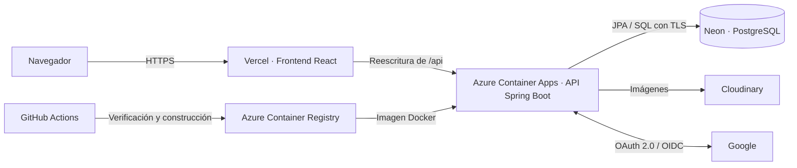
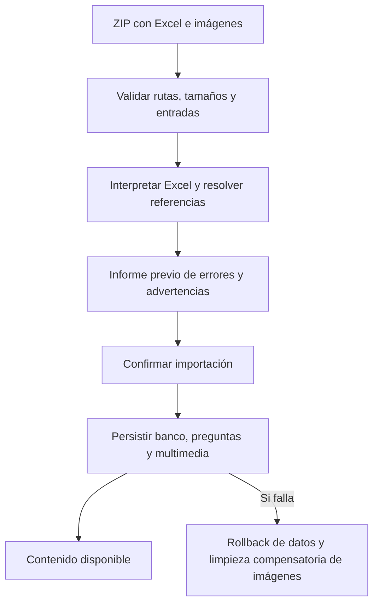

# Cuestion.me
### Plataforma web Full Stack de cuestionarios y autoevaluación académica

**[Abrir aplicación](https://www.cuestion-me.app)** · [Volver al portafolio](../../README.md)

Cuestion.me convierte bancos de preguntas en sesiones de práctica y evaluaciones con corrección automática. Permite crear y organizar contenido por contexto académico, compartir cuestionarios publicados y consultar resultados sin perder la versión de las preguntas utilizadas en cada intento.

**Foco técnico:** backend Java, seguridad por recurso, integridad del historial, procesamiento de archivos y entrega cloud. El código fuente permanece privado; esta presentación no incluye implementaciones ni configuración reservada.

## Problema y usuarios

Preparar evaluaciones implica reunir preguntas, mantener su clasificación y revisar respuestas. La aplicación reúne ese recorrido: estudiantes pueden crear contenido propio, explorar cuestionarios publicados y practicar; la administración dispone de herramientas para mantener el catálogo académico.

El catálogo relaciona universidades, facultades, carreras, planes de estudio, niveles y materias. Esta clasificación permite ubicar los bancos dentro de un contexto académico consistente.

## Funcionalidades implementadas

- Creación y edición de bancos, consignas compartidas, preguntas, opciones y etiquetas.
- Estados de visibilidad: borrador, privado y público; exploración de contenido publicado con filtros académicos.
- Inicio de intentos, selección de preguntas, guardado de progreso y finalización con corrección automática.
- Historial, detalle de resultados, resúmenes y evolución.
- Creación manual e importación de paquetes ZIP con Excel e imágenes; exportación al formato ZIP reutilizable.
- Registro local, ingreso, verificación de correo, recuperación de contraseña e integración Google OpenID Connect configurable.
- Administración e importación del catálogo académico, con permisos específicos.

El acceso y los límites de creación se validan en el servidor. Las capacidades disponibles dependen de la cuenta, la configuración y los permisos.

## Stack verificado

| Capa | Implementación |
| --- | --- |
| Backend | Java 25 · Spring Boot 4.1.1 · Maven · Spring Web MVC |
| Seguridad | Spring Security · Sesiones · OAuth 2.0 / Google OpenID Connect |
| Persistencia | Spring Data JPA · Hibernate · PostgreSQL 17 · Flyway |
| Frontend | React 19.2 · JavaScript · Vite 7 · Tailwind CSS 4 |
| Archivos y contenido | Apache POI · ExcelJS · KaTeX · Cloudinary |
| Calidad | JUnit 5 · Mockito · AssertJ · Testcontainers · Node.js Test Runner |
| Ejecución y cloud | Docker · Docker Compose · Nginx · Azure Container Apps · Azure Container Registry · Vercel · Neon |
| Automatización | GitHub Actions para verificación, imagen y despliegue del backend |

Las versiones describen la configuración revisada, no una auditoría de las instancias en ejecución.

## Arquitectura

El backend es una aplicación Spring Boot organizada en controladores, servicios, modelos y acceso a persistencia. Los servicios concentran reglas de negocio y límites transaccionales. El frontend React separa componentes de cuestionarios, práctica, resultados, autenticación y administración, con módulos para API, importación y sincronización del editor.

El diagrama representa la configuración cloud encontrada en el proyecto. El flujo OAuth incluye también redirecciones del navegador. La reescritura del frontend dirige las llamadas a la API sin publicar aquí direcciones internas.

En desarrollo, Docker Compose coordina PostgreSQL, backend y frontend servido por Nginx. Esta topología local es distinta del frontend alojado en Vercel.

### API REST

La API usa el prefijo `/api/v1`, representaciones JSON, identificadores UUID y listados paginados. Sus familias incluyen autenticación, catálogo académico, bancos, preguntas, cuestionarios, intentos, resultados y multimedia.

Las operaciones de escritura exigen una sesión y protección CSRF donde corresponde. Los errores de dominio se expresan mediante respuestas estructuradas; los conflictos de estado y permisos se validan antes de modificar datos.

## Persistencia e integridad

El dominio distingue bancos de preguntas, consignas, preguntas/opciones, configuraciones de cuestionario e intentos. Incluye cuentas, catálogo académico y referencias multimedia.

- **Flyway** versiona los cambios del esquema; Hibernate valida su correspondencia al iniciar.
- **Transacciones de servicio** agrupan operaciones relacionadas, como cargas completas de contenido.
- **Snapshots persistidos** conservan preguntas, opciones, consignas y claves utilizadas por cada intento. Editar o desactivar los originales no reescribe una evaluación histórica.
- **Bloqueo pesimista del intento** serializa respuestas y finalización; un intento cerrado rechaza nuevas respuestas.
- **Bloqueos transaccionales de PostgreSQL** protegen operaciones sujetas a cuotas y límites.
- **Desactivación lógica** permite conservar referencias históricas.

## Seguridad y autenticación

La autenticación local usa Spring Security y sesiones; Google OIDC se habilita mediante configuración. La implementación contempla verificación de correo, recuperación de contraseña y vinculación de identidad Google con comprobaciones explícitas.

La autorización combina roles y propiedad del recurso. El backend verifica el propietario de bancos e intentos y restringe las operaciones administrativas. Ocultar un botón en React no sustituye estas validaciones.

Las escrituras del cliente incorporan CSRF. La configuración productiva exige conexiones de base con TLS y configura cookies seguras sobre HTTPS. También hay controles de frecuencia para flujos sensibles y cargas multimedia, validación de contenido y pruebas de acceso indebido.

La corrección visible depende del modo y estado del intento: en examen las claves se reservan hasta finalizar; otros modos permiten retroalimentación durante la práctica. Esta distinción evita afirmar que todos los modos revelan respuestas de la misma manera.

## ZIP, Excel y multimedia

El paquete de intercambio reúne un libro Excel y sus imágenes. El análisis previo informa problemas antes de confirmar la importación; la carga valida estructura, referencias, metadatos y políticas de límite.

La validación ZIP rechaza rutas absolutas o con recorrido de directorios, duplicados y excesos de tamaño o cantidad de entradas. Apache POI interpreta el libro en el backend; el frontend incorpora herramientas ExcelJS.

El servicio multimedia procesa imágenes, las convierte a WebP y reutiliza archivos por hash dentro del mismo propietario. El almacenamiento tiene una abstracción con implementaciones local y Cloudinary.

**Decisión relevante:** una transacción de base de datos no revierte por sí sola una carga externa. La importación registra recursos nuevos y aplica limpieza compensatoria ante fallos; existe además gestión de recursos huérfanos. La exportación reconstruye un ZIP reutilizable con el contenido y sus imágenes.

## Rendimiento: guardar solo lo que cambió

El guardado del formulario reescribía preguntas sin cambios al editar únicamente metadatos. La solución compara el contenido con su estado persistido, omite escrituras innecesarias y actualiza el estado de referencia después de cada operación exitosa. Esto permite reintentar un guardado parcial sin recrear contenido ya confirmado.

En el backend, la edición de metadatos usa dirty checking transaccional y consultas acotadas; no necesita cargar preguntas, opciones, intentos ni assets. El cargador del editor comparte solicitudes simultáneas en curso y vuelve a consultar al reabrir.

### Evidencia local registrada

| Escenario | Antes | Después |
| --- | ---: | ---: |
| Sentencias SQL preparadas, formulario de 300 preguntas | 1.809 | 5 |
| Entidades cargadas | 916 | 2 |
| Tiempo observado | 2.283,193 ms | 9,004 ms |

**Alcance:** medición local con PostgreSQL 17.11 en Testcontainers y Java 25; incluye llamadas a servicios y commits de transacciones. **No incluye HTTP, CSRF, serialización JSON ni red, y no representa un benchmark de producción.** Son muestras individuales, con calentamiento variable; no son medianas ni percentiles.

El repositorio original contiene el registro CSV y la prueba de integración que cuenta sentencias y entidades. El escenario reproduce el flujo de guardado de metadatos del formulario, no el tiempo total de navegación o edición. Las regresiones verifican el costo SQL sin imponer un umbral de tiempo frágil. No se copiaron archivos privados de medición a este portafolio.

## Testing y calidad

La implementación incluye pruebas unitarias con JUnit y Mockito, pruebas de integración sobre PostgreSQL mediante Testcontainers y pruebas del cliente con Node.js Test Runner.

Las suites inspeccionadas cubren autorización, sesiones, recuperación y verificación de cuentas, importación/exportación, cuotas, multimedia, conservación de intentos y presupuestos SQL. Las pruebas del frontend abarcan sincronización del editor, reintentos, importación, permisos, progreso y resultados.

Esta documentación se preparó mediante revisión del código y de sus evidencias. No se ejecutaron las pruebas de la aplicación durante el trabajo de portafolio ni se atribuye a esta revisión un resultado nuevo de ejecución.

## Infraestructura y CI/CD

El workflow del backend ejecuta verificación Maven, autentica con Azure mediante OIDC, construye una imagen Docker identificada por commit, la publica en Azure Container Registry y actualiza Azure Container Apps. Después consulta el estado de la revisión y el endpoint de salud.

El frontend contiene configuración Vercel con reescritura de API. La configuración productiva distingue conexiones de aplicación y migraciones para Neon: Flyway utiliza el endpoint directo, evitando ejecutar migraciones a través del pooler.

La existencia del pipeline confirma la automatización implementada; no implica afirmar que cada despliegue histórico haya finalizado correctamente ni que se haya probado un despliegue nuevo en esta revisión.

## Desafíos y soluciones

| Desafío | Decisión implementada |
| --- | --- |
| Cambios en preguntas que podrían alterar evaluaciones anteriores | Copias persistidas por intento y desactivación lógica |
| Respuestas y cierre concurrentes | Bloqueo del intento y validación de su estado |
| Importaciones con recursos externos | Análisis previo, transacción de datos y compensación multimedia |
| Edición de metadatos con costo creciente | Comparación de contenido y escrituras limitadas a cambios |
| Clasificación académica inconsistente | Catálogo canónico, asociaciones y validaciones |
| Entrega reproducible del backend | Imagen Docker y workflow de verificación y despliegue |

## Demostración y capturas

**[Visitar Cuestion.me](https://www.cuestion-me.app)**

La URL pública respondió durante la revisión, pero la portada permaneció en “Cargando tu sesión”. No se incorporó esa pantalla como evidencia visual de las funcionalidades ni se verificaron flujos autenticados en producción.

El [plan de capturas](../../assets/cuestionme/README.md) detalla las vistas pendientes. No se fabricaron imágenes ni se reutilizaron datos de usuarios.

## Aprendizajes y evolución

El proyecto permite trabajar decisiones concretas: delimitar transacciones, separar identidad de autorización, conservar historia de negocio y medir el costo de un flujo completo en lugar de observar solo un endpoint.

Como evolución propuesta —no funcionalidades entregadas—: medir latencia con navegador y red reales, ampliar la verificación de recorridos de usuario y estudiar control de versiones para ediciones concurrentes de metadatos. Un modo de edición exclusivo de metadatos también podría evitar cargar todas las preguntas al abrir el editor.

---
[Volver al catálogo](../README.md)
